# 🏥 Hospital Bed Capacity Prediction Using Machine Learning

A machine learning project that predicts hospital bed capacity (Low / Medium / High) using five classification algorithms. Built with Python, scikit-learn, pandas, and matplotlib.

---

## 📋 Table of Contents

- [About](#about)
- [Dataset](#dataset)
- [Features Used](#features-used)
- [ML Models Implemented](#ml-models-implemented)
- [Results](#results)
- [Screenshots](#screenshots)
- [How to Run](#how-to-run)
- [Tech Stack](#tech-stack)

---

## 📖 About

This project analyzes the **Indian Hospital Directory** dataset and classifies hospitals into **three bed-capacity categories** — *Low*, *Medium*, and *High* — using five supervised learning models. The goal is to compare model performance and identify the most influential features for predicting hospital capacity.

---

## 📊 Dataset

- **Source:** Hospital Directory CSV (`hospital_directory.csv`)
- **Shape:** 30,273 rows × 48 columns
- **Target Variable:** `Bed_Category` (derived from `Total_Num_Beds` using quantile binning)

> **Note:** The CSV file is not included in this repo due to its size. Place your own `hospital_directory.csv` in the project root before running.

---

## 🔢 Features Used

| Feature | Type |
|---|---|
| `Total_Num_Beds` | Numeric (used to create target) |
| `Number_Doctor` | Numeric |
| `Num_Mediconsultant_or_Expert` | Numeric |
| `Establised_Year` | Numeric |
| `Hospital_Category` | Categorical |
| `Hospital_Care_Type` | Categorical |
| `Discipline_Systems_of_Medicine` | Categorical |
| `State` | Categorical |
| `Emergency_Services` | Categorical |
| `Tariff_Range` | Categorical |

---

## 🤖 ML Models Implemented

1. **K-Nearest Neighbors (KNN)** — k = 5, with StandardScaler
2. **Naive Bayes** — Gaussian NB
3. **Decision Tree** — Gini impurity, full depth
4. **Support Vector Machine (SVM)** — RBF kernel, with StandardScaler
5. **Random Forest** — 100 estimators

All models use a **70-30 stratified train-test split**.

---

## 📈 Results

### Model Comparison

| Model | Accuracy | Precision | Recall | F1 Score |
|---|---|---|---|---|
| **Naive Bayes** | **0.774** | **0.837** | **0.774** | **0.775** |
| Random Forest | 0.726 | 0.741 | 0.726 | 0.727 |
| Decision Tree | 0.726 | 0.761 | 0.726 | 0.733 |
| SVM | 0.714 | 0.716 | 0.714 | 0.714 |
| KNN | 0.667 | 0.708 | 0.667 | 0.673 |

> **Best Model:** Naive Bayes with **77.4% accuracy**

### Top 10 Important Features (Random Forest)

1. `Establised_Year`
2. `State_Maharashtra`
3. `Hospital_Care_Type_Hospital`
4. `State_Gujarat`
5. `State_Uttar Pradesh`
6. `State_Himachal Pradesh`
7. `Hospital_Category_Private`
8. `State_Telangana`
9. `State_Karnataka`
10. `State_Tamil Nadu`

---

## 📸 Screenshots

### Data Exploration

| Hospital Categories | Bed Capacity Distribution | Total Beds Histogram | Doctors vs Beds |
|---|---|---|---|
| 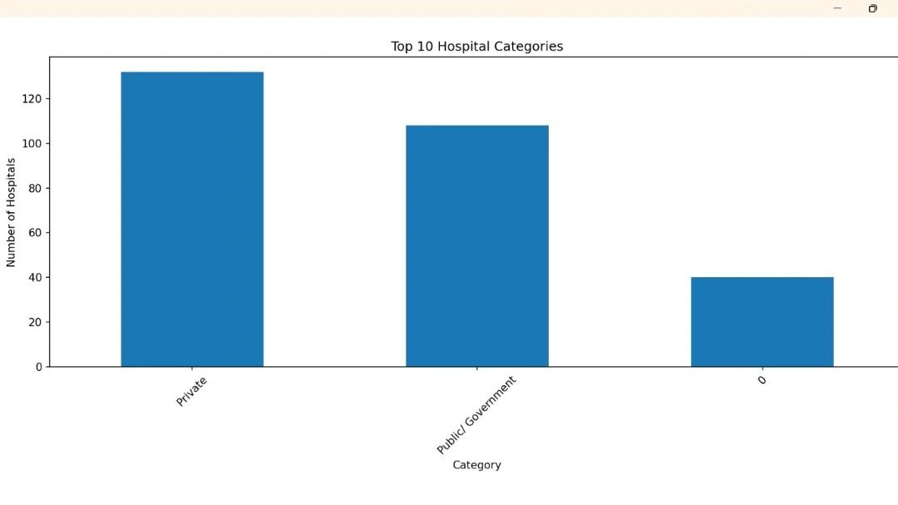 | 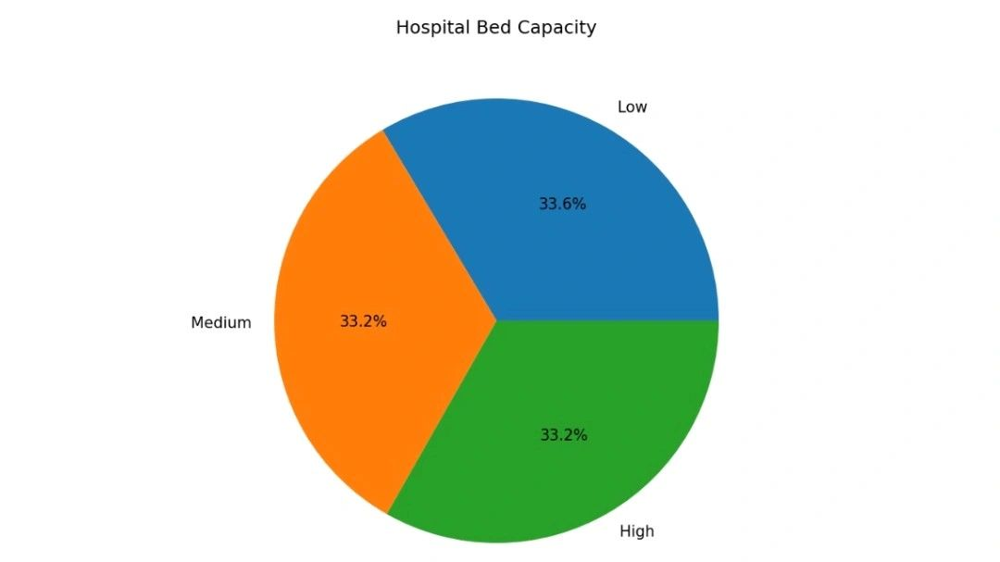 | 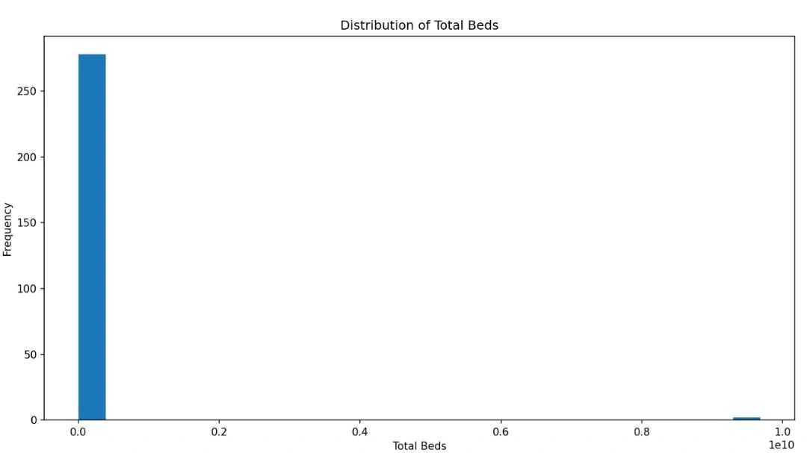 | 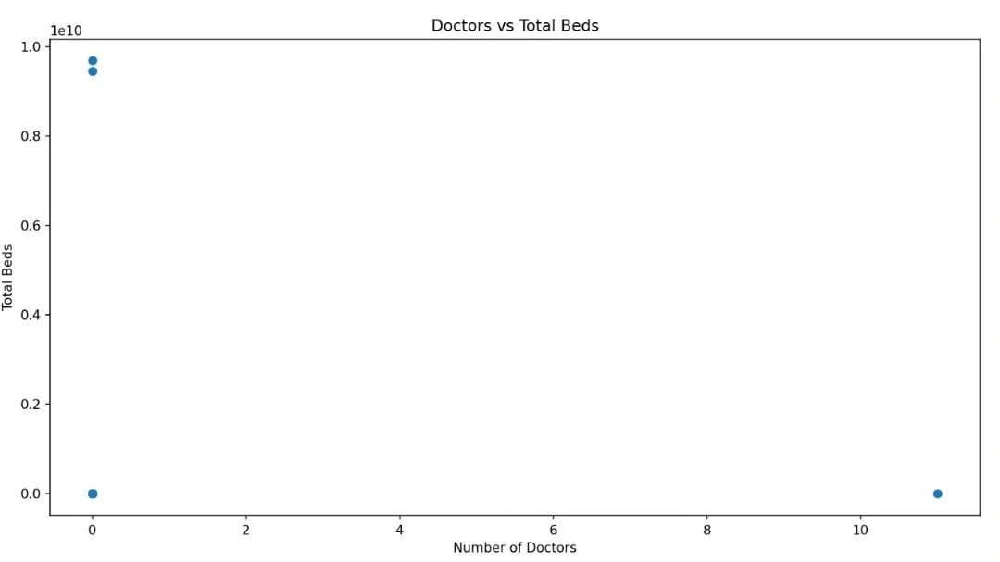 |

### Model Accuracy Comparison

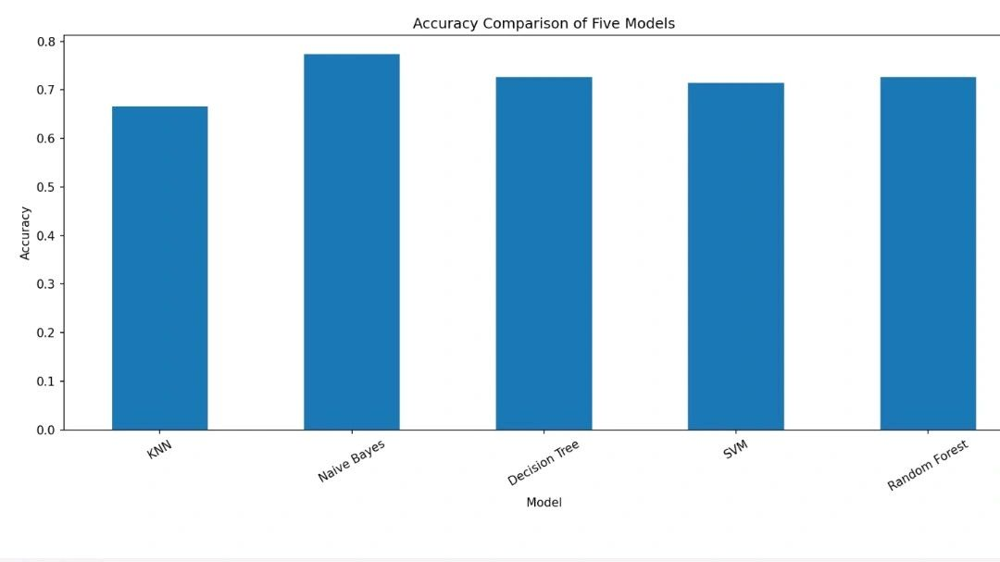

### Confusion Matrices

| KNN | Naive Bayes | Decision Tree |
|---|---|---|
| 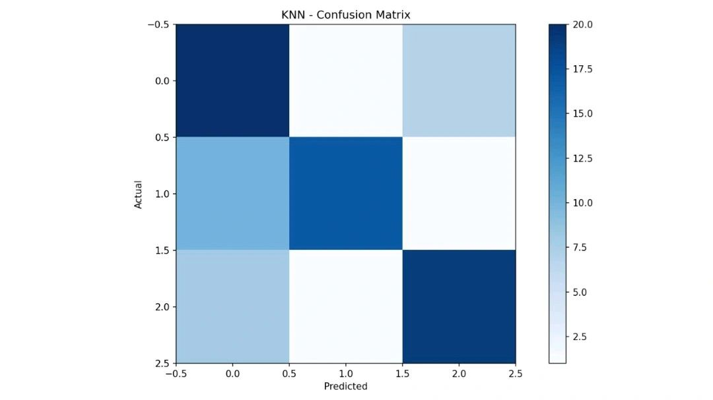 | 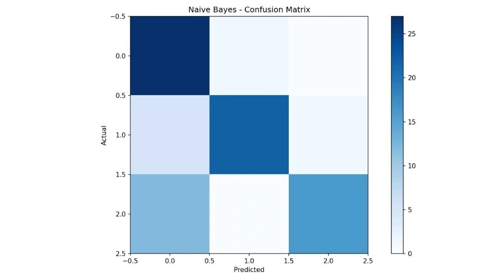 | 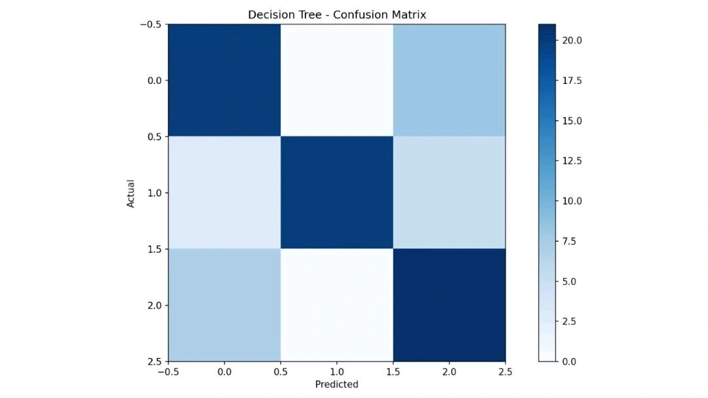 |

| SVM | Random Forest |
|---|---|
| 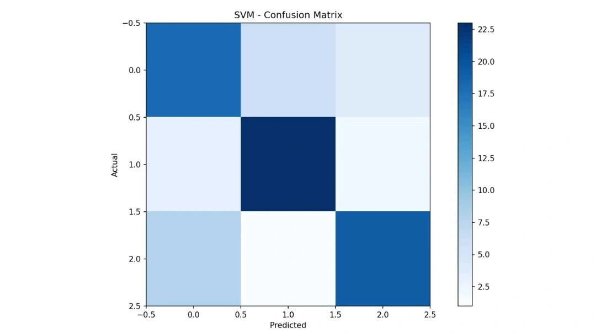 | 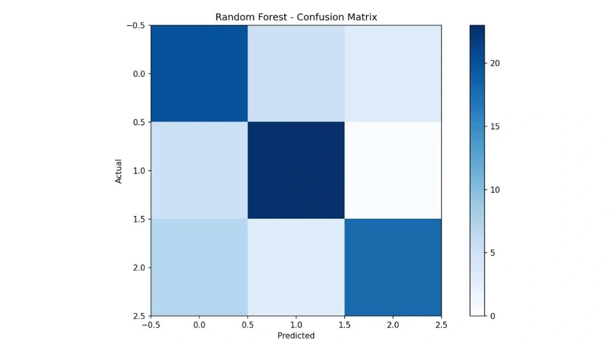 |

### Decision Tree Visualization

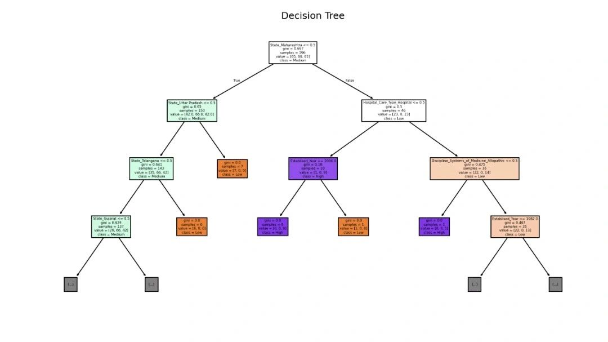

### Feature Importance (Random Forest)

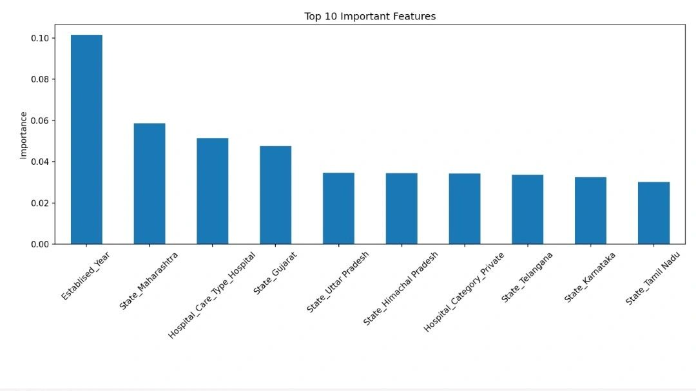

### Detailed Model Output

| Dataset Overview & KNN Results | SVM & Random Forest Results | Model Comparison Table |
|---|---|---|
| 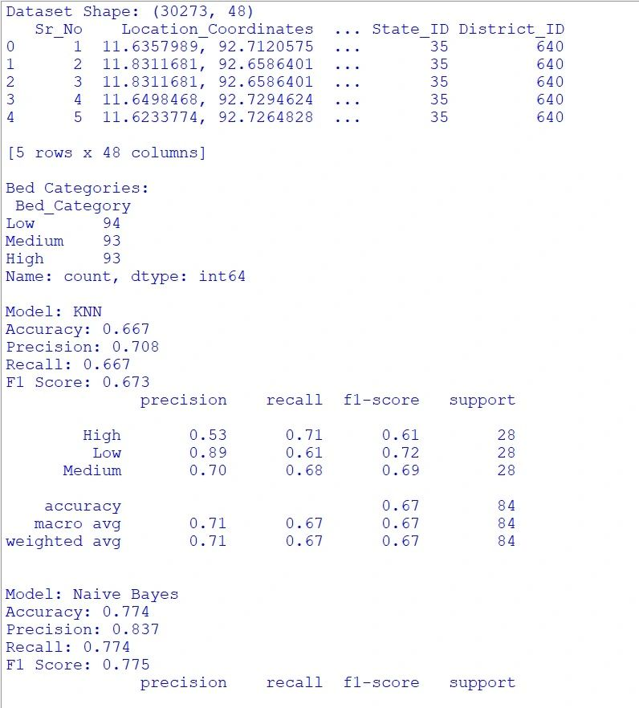 | 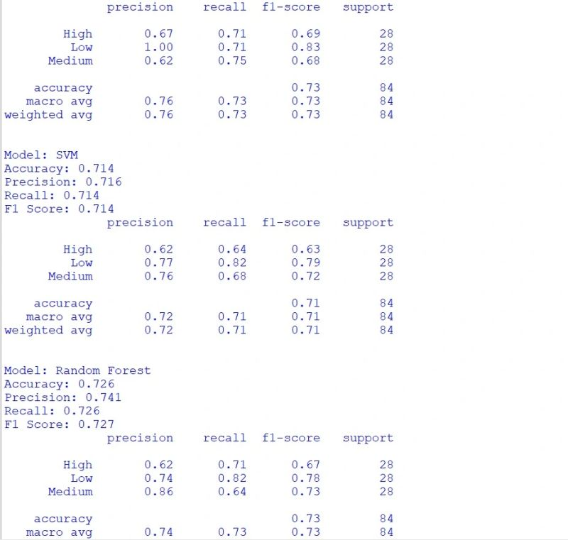 | 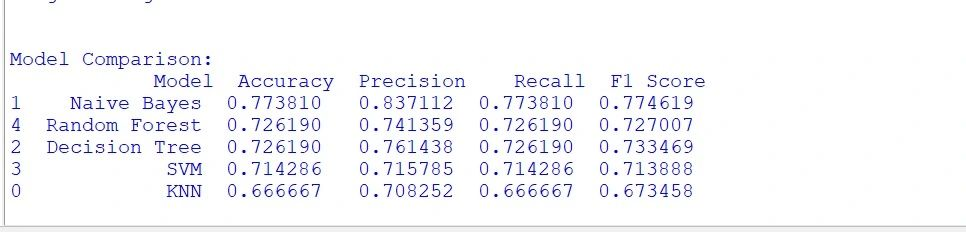 |

---

## 🚀 How to Run

1. **Clone the repository:**
   ```bash
   git clone https://github.com/Sumitlap04/Hospital-Bed-Capacity-Prediction.git
   cd Hospital-Bed-Capacity-Prediction
   ```

2. **Install dependencies:**
   ```bash
   pip install pandas matplotlib scikit-learn
   ```

3. **Place your dataset:**
   - Download/copy `hospital_directory.csv` into the project root
   - Update the file path in `project.py` (line 18) if needed:
     ```python
     df = pd.read_csv("hospital_directory.csv")
     ```

4. **Run the project:**
   ```bash
   python project.py
   ```

---

## 🛠 Tech Stack

- **Language:** Python 3
- **Libraries:** pandas, matplotlib, scikit-learn
- **Algorithms:** KNN, Naive Bayes, Decision Tree, SVM, Random Forest

---

## 📄 License

This project is for educational purposes.
